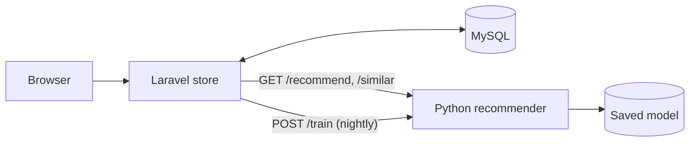

# ShopSense

An e-commerce platform with an automated recommendation engine.

A **Laravel** storefront (catalogue, search, cart, checkout, orders, admin) records what shoppers view, add to cart and buy. A separate **Python (FastAPI + scikit-learn)** service learns from those events and returns ranked product suggestions. If the service is slow or down, the store falls back to best sellers, so shopping never breaks.



## Features

- Product catalogue with categories, search and category filters
- Session cart, simulated checkout with stock checks inside a database transaction
- User accounts and order history
- Admin panel to add, edit and hide products
- Event tracking (`view`, `cart`, `purchase`) that feeds the recommender
- Recommendation rows on the home page ("Recommended for you") and product pages ("Customers also looked at")
- Nightly retraining through the Laravel scheduler (`recommender:sync`)
- Graceful fallback to best sellers when the recommender is unavailable

## How the recommender works

| Signal | What it does | When it matters most |
|---|---|---|
| Popularity | Ranks by weighted views, carts and purchases | New visitors (cold start) |
| Item-item collaborative filtering | "People who bought this also bought that", cosine similarity on the user-item matrix | Shoppers with history |
| Content similarity | TF-IDF on name, description and category | New products and light history |

The three scores are blended per shopper. The more history a shopper has, the more weight collaborative filtering gets. Guests are served from the products they viewed in the current session.

Events are weighted (`view` 1, `cart` 3, `purchase` 5) and log-damped so repeated views do not dominate.

### Offline evaluation

`python recommender/evaluate.py` holds out one purchase per shopper, trains on the rest, and checks whether it appears in the top 10. Results on the bundled synthetic data (254 shoppers):

| Model | HitRate@10 | NDCG@10 | Coverage |
|---|---|---|---|
| Popularity (baseline) | 0.161 | 0.086 | 0.375 |
| Item-item CF | 0.291 | 0.169 | 1.000 |
| Content (TF-IDF) | 0.260 | 0.156 | 1.000 |
| **Hybrid** | **0.315** | **0.177** | **1.000** |

The data is synthetic, with shoppers who prefer one or two categories, so treat the numbers as a regression check and a demonstration of method, not as a claim about real customers. With one held-out item per shopper, Recall@10 equals HitRate@10.

## Quick start

Requirements: PHP 8.2+, Composer, Python 3.10+.

```bash
# 1. Build the store (creates a fresh Laravel app, adds ShopSense on top, migrates and seeds)
./scripts/setup-store.sh

# 2. Start the recommender
cd recommender
python -m venv .venv && source .venv/bin/activate
pip install -r requirements.txt
uvicorn app.main:app --port 8001

# 3. Train it from the store's data (new terminal)
cd store && php artisan recommender:sync

# 4. Run the store
php artisan serve        # http://127.0.0.1:8000
```

Demo logins: `admin@shopsense.test` / `password` (admin) and `demo@shopsense.test` / `password`.

### With Docker

```bash
./scripts/setup-store.sh        # once, to create the full Laravel app
docker compose up --build
docker compose exec store php artisan db:seed --force
docker compose exec store php artisan recommender:sync
```

## Tests

```bash
cd recommender && pip install -r requirements-dev.txt && pytest -q
cd store && php artisan test
```

## Recommender API

| Method and path | Purpose |
|---|---|
| `GET /health` | Service and model status |
| `POST /train` | Train from `{products, interactions}` and save the model |
| `GET /recommend/user/{id}?k=8&exclude=1,2` | Personal picks for a known shopper |
| `GET /recommend/seed?product_ids=1,2,3` | Picks for a guest from recently viewed products |
| `GET /similar/{product_id}?k=6` | Products similar to one product |

Interactive docs are at `http://127.0.0.1:8001/docs`.

## Project layout

```
shopsense/
├── store/                  Laravel app
│   ├── app/Services/RecommenderClient.php   HTTP client, caching, fallback
│   ├── app/Console/Commands/SyncRecommender.php
│   ├── app/Http/Controllers/                Shop, Cart, Checkout, Orders, Auth, Admin
│   ├── database/migrations, seeders, factories
│   ├── resources/views/                     Blade + Tailwind (CDN)
│   └── tests/Feature/
├── recommender/            FastAPI service
│   ├── app/engine.py       Hybrid model
│   ├── app/main.py         API
│   ├── app/synthetic.py    Demo and evaluation data
│   ├── evaluate.py         Offline metrics
│   └── tests/
├── scripts/setup-store.sh
├── docker-compose.yml
└── .github/workflows/ci.yml
```

## Roadmap

- Real payments (Stripe or Razorpay) instead of the simulated checkout
- Move retraining to a queue and train incrementally
- Add implicit-feedback matrix factorisation (ALS) and compare it in `evaluate.py`
- Store the model in object storage and version it
- A/B test recommendation rows and track click-through rate

## Licence

MIT
